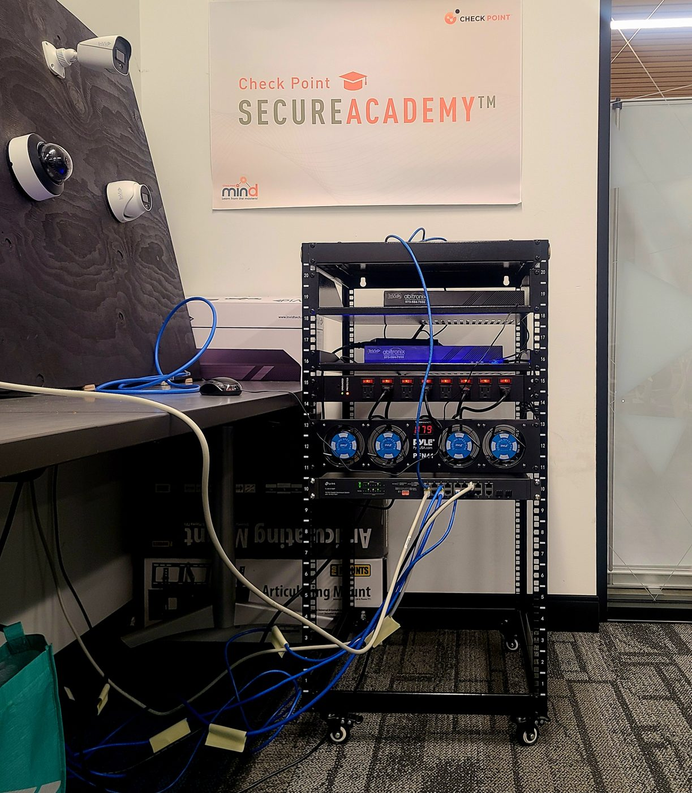
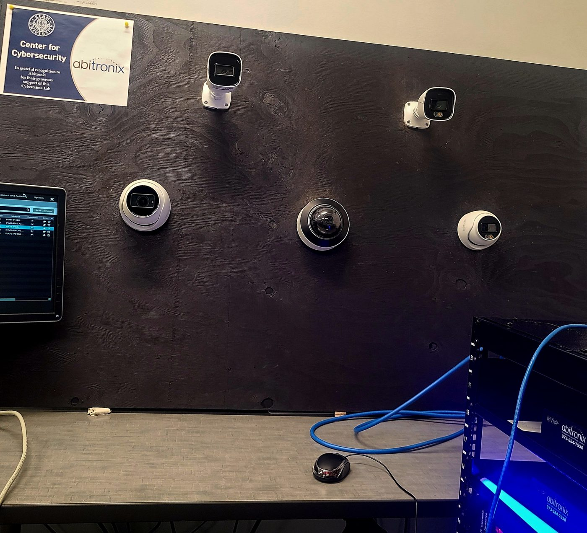
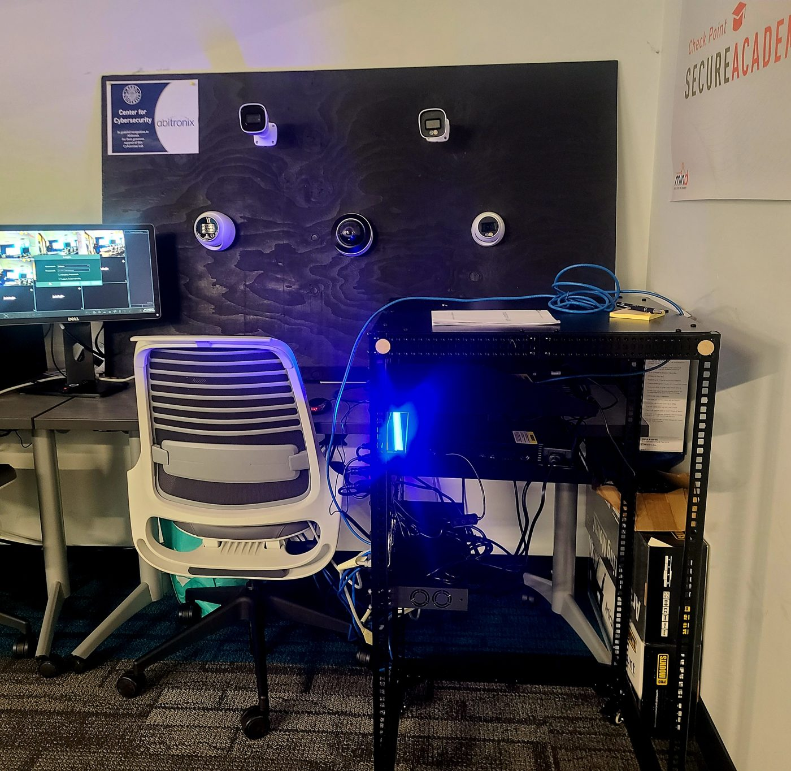
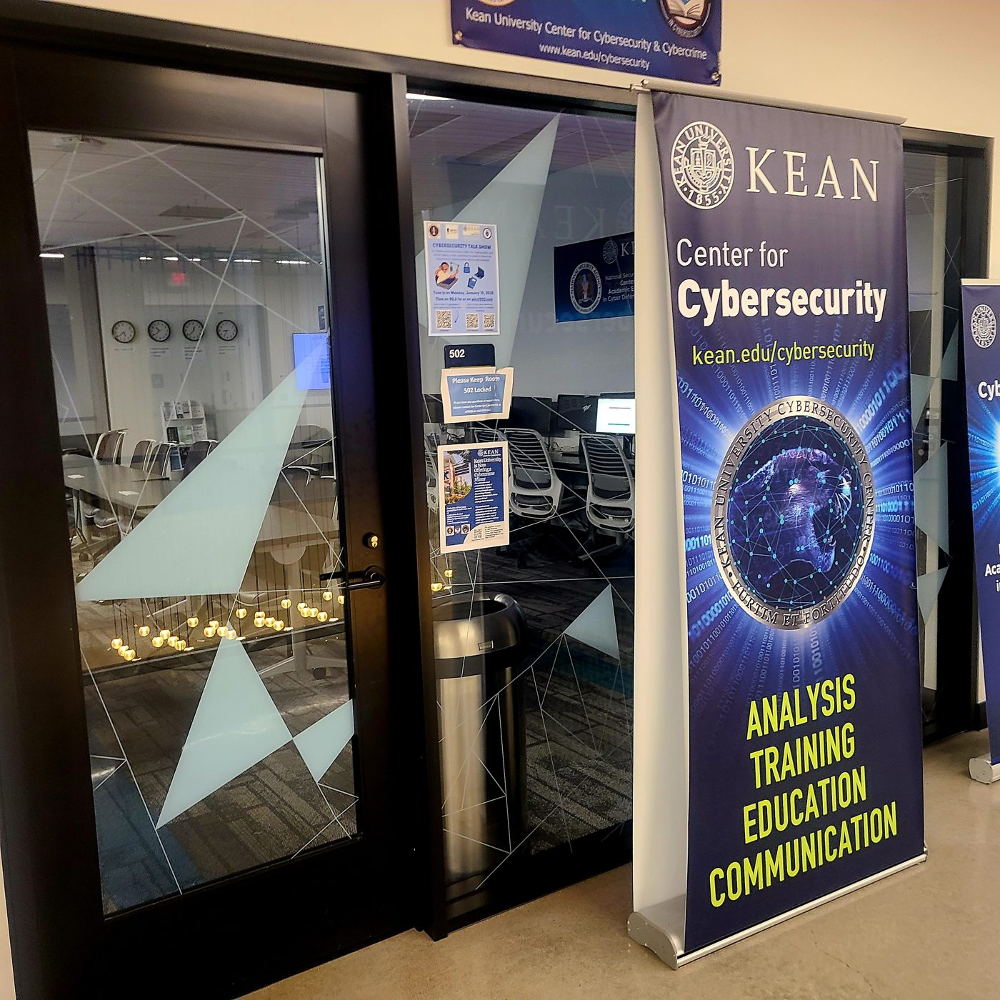

# AI-Assisted Surveillance System (NVR + IP Cameras)

This repository documents a hands-on lab project focused on building and documenting an **AI-assisted physical security surveillance system** using an **NVR**, **PoE switch**, and multiple **IP cameras**.

## What we worked on

- **Networking fundamentals in a real environment** (subnetting, IP addressing, troubleshooting connectivity)
- **Setting up a rack** and organizing the physical infrastructure cleanly
- **Deploying and configuring a PoE switch + NVR** so multiple IP cameras could be powered, connected, and managed from one place
- **Testing and validating multiple IP cameras**, including models with built-in **AI tracking features** (smart detection/auto-tracking) to understand how “intelligent” surveillance works at the edge

## Lab photos

Built at the **Kean University Center for Cybersecurity**.

| Rack: PoE switch, NVR, power | Camera test wall |
|---|---|
|  |  |
| **Full setup with NVR monitor** | **Kean Center for Cybersecurity** |
|  |  |

## Security considerations

IP cameras are a common way into a network (Mirai-style botnets, default credentials, exposed web UIs). Good practices for a deployment like this:

- Put cameras on their own **VLAN / subnet**, with no route to user devices
- Change **default credentials** and keep firmware updated
- Block camera access to the internet. Only the NVR should talk to them.
- Turn off UPnP and P2P cloud features unless they are needed

## Skills demonstrated

Networking (subnetting, IP addressing, troubleshooting) · PoE · NVR configuration · rack and cable management · physical security · IoT security

## Key takeaway

It was interesting exploring another aspect of cybersecurity: **physical security**. Additionally, understanding how **AI can be applied in a security-focused way**—from smarter surveillance features to more effective monitoring and response—helped connect the technical setup to real security outcomes.
